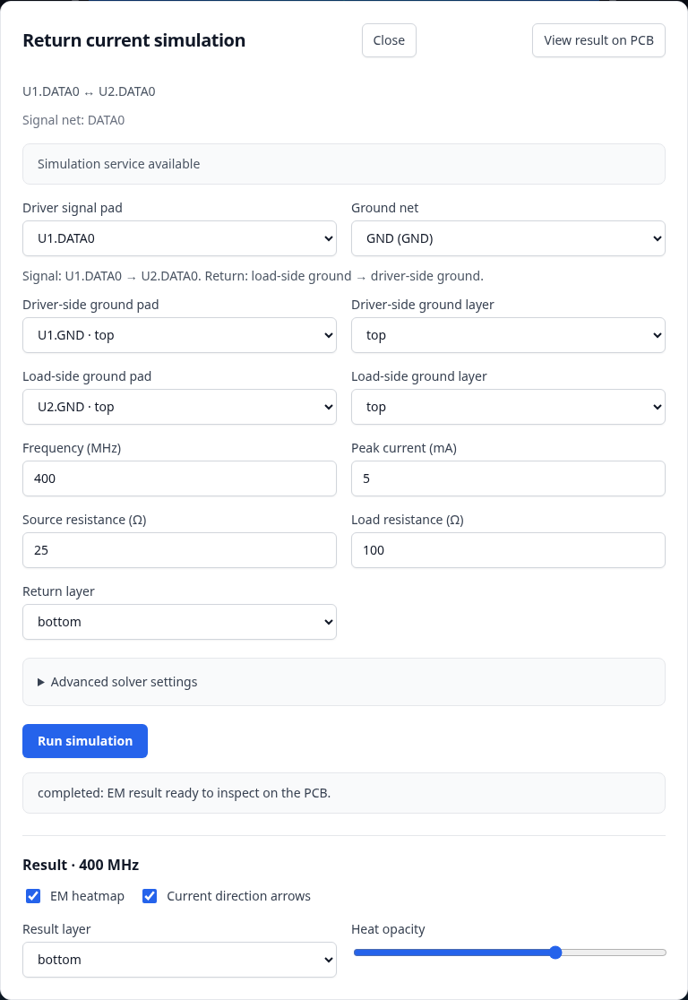
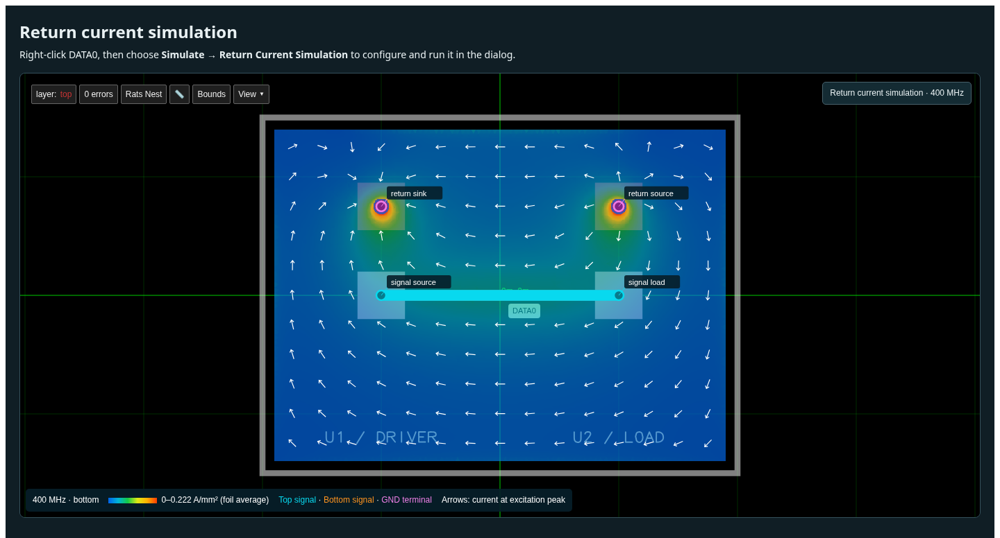

# PCB viewer return-current development prototype

This example starts with the PCB alone. Right-click DATA0 and choose **Simulate → Return Current Simulation** to open the configuration dialog. Review the actual signal/GND terminals, frequency and electrical model, then choose **Run simulation**. The configured service executes a fresh Palace EM solve and returns official Circuit JSON result/field/heatmap/marker records.

Backend availability, configuration, job status and result controls live inside the dialog. Closing it preserves edited settings and lets an active job continue. The compact **Return current simulation** button reopens the same configuration and job. Once complete, choose **View result on PCB** to close the dialog and inspect the heatmap, layer-coloured signal trace and physical GND terminals. Reopen the dialog to change heatmap opacity or arrow visibility.

**Simulate** is the last context-menu entry. The dialog uses Tailwind's default light palette and loads the pinned Tailwind CDN runtime on first use. Its prefixed styles are scoped to the dialog so the PCB viewer and host page retain their existing styles. A light fallback keeps the controls usable if the CDN is blocked.

## Hosted and local API

The hosted execution service is maintained independently in [tscircuit/simulate.tscircuit.com](https://github.com/tscircuit/simulate.tscircuit.com). All Worker, container, storage, and deployment configuration lives there. This repository contains the viewer and a local development adapter.

Production builds target `https://simulate.tscircuit.com/api`; the separate service must be deployed before that endpoint is usable. Local development proxies only `/api/simulations/*` to the adapter at `http://127.0.0.1:3031`. Other CLI API namespaces remain free for their existing handlers.

Set `VITE_RETURN_CURRENT_API_URL` to the server's `/api` root. The client appends `/simulations/v1/return-current`; do not include that suffix twice. For an equivalent local CLI server:

```sh
VITE_RETURN_CURRENT_API_URL=http://localhost:3020/api bun run cosmos-export
```

The same contract serves health, job submission, status, and results:

- `GET /api/simulations/v1/return-current/health`
- `POST /api/simulations/v1/return-current/jobs`
- `GET /api/simulations/v1/return-current/jobs/:request_id`
- `GET /api/simulations/v1/return-current/jobs/:request_id/result`

Results are direct Circuit JSON arrays, addressed by job ID. The viewer never calls the CLI's `/api/events/*` or `/api/files/*` routes to execute a simulation. Add an explicit frontend origin to the hosted service's allowlist when using a separate browser origin. A connection failure appears inside the dialog.

## Run locally

Install the JavaScript dependencies and a Python environment for the simulator. Docker must be running; the simulator uses its pinned Palace image.

```sh
bun install
python3.12 -m venv .tscircuit/palace-python
.tscircuit/palace-python/bin/pip install -r node_modules/simulate-return-current/dist/python/requirements.txt
PALACE_PYTHON="$PWD/.tscircuit/palace-python/bin/python" bun run dev:cli
```

In a second terminal:

```sh
bun run dev:return-current
```

Open **http://127.0.0.1:3000/tests/return-current-dev/**. The same example is available in Cosmos as `2026/return-current` when the local simulation adapter is running.

Submitting a run puts its request ID in the URL. Keep that URL to reopen the completed result after a page refresh or simulation-server restart; no new solve is submitted. The dialog configures the next run, while the overlay legend identifies the loaded result. Reopening the dialog or changing display controls does not submit a simulation. If the backend is unavailable, **Retry backend connection** checks it again; a failed job can be retried explicitly.

On virtual CPUs where the pinned image exits before its banner with a floating-point exception, use the optional compatibility launcher:

```sh
PALACE_BIN="$PWD/scripts/return-current/palace-container.ts" PALACE_PYTHON="$PWD/.tscircuit/palace-python/bin/python" bun run dev:cli
```

This disables a faulty hwloc CPUID probe in the container; the mesh, physical model and numerical settings stay unchanged.

Defaults are 400 MHz, 5 mA peak excitation, 25 Ω source and 100 Ω load, 0.01 mm sampling, a 0.5 mm FEM target and second-order elements. Physical GND return pads are separate from signal pads. A default native run can take several minutes. The PNG cells and sampled field values are not smoothed to hide mesh facets; numerical convergence is a separate check.

## Prototype boundary

This repository contains the viewer workflow and a local simulation adapter; deployment code lives in the separate service repository. CLI and Runframe are unchanged. The adapter queues real simulations serially, deduplicates request IDs, and exposes the same versioned return-current endpoints as hosting. Its optional status-event feed also stays under the simulation namespace. Original board geometry is preserved when result records are appended. Large native files stay in ignored `.tscircuit/return-current-dev/` directories.

The viewer owns the dialog and its state. Its `returnCurrentSimulationDialog` option accepts a typed client, an optional request ID to resume, and callbacks for request IDs and completed results. The example supplies an HTTP client for the configured service; another host can inject the same interface. The existing context-menu callback remains available for hosts with a custom simulation workflow.

```tsx
import {
  PCBViewer,
  createReturnCurrentSimulationClient,
} from "@tscircuit/pcb-viewer"
import type { AnyCircuitElement } from "circuit-json"

const client = createReturnCurrentSimulationClient()

export const Board = ({ circuitJson }: { circuitJson: AnyCircuitElement[] }) => (
  <PCBViewer
    circuitJson={circuitJson}
    returnCurrentSimulationDialog={{ client }}
  />
)
```

Keep the client stable across renders. The dialog manages configuration, submission, polling and result controls internally.

The existing two-layer reference mesher rejects extra unexcited pads, so this fixture intentionally contains one complete signal connection and its GND return. Four-layer/high-frequency support and handling unrelated board copper remain backend work. CLI and Runframe integration can be designed around the working versioned simulation contract after this prototype is reviewed.

## Verify the real workflow

```sh
bunx playwright install chromium
PALACE_PYTHON="$PWD/.tscircuit/palace-python/bin/python" bun run test:return-current
```

The opt-in browser test starts its own simulation/Vite servers and submits exactly one fresh real solve on every invocation. It checks the trace context action, modal configuration, result-free input definitions, distinct ground contacts, closing/reopening during a running job, returned heatmap/vectors, display controls, zoom alignment, and reloading the completed result without another submission. Screenshots and a receipt are saved under ignored `tests/return-current-dev/actual/`. To exercise already running servers, set `RETURN_CURRENT_BROWSER_URL=http://127.0.0.1:3000/`.

For bounded dialog checks without starting an EM solve:

```sh
bun tests/return-current-dev/lifecycle.ts
```

This uses an injected typed client to check backend unavailability/retry, submission and job errors, focus trapping, Escape/focus restoration, edited settings, and closing/reopening a running job without duplicate submission. It also checks that Simulate is the last context-menu entry, keyboard submenu navigation, and near-bottom placement at desktop and small-screen sizes. The styling check loads the actual pinned Tailwind CDN through the runtime's normal TLS/proxy trust, verifies lazy singleton loading and unchanged host styles/configuration, then blocks the CDN to exercise the usable light fallback. It deliberately produces no simulation result; its screenshots and receipt are UI/transport evidence only.

To check the modal and PCB against an already completed **real** local job, supply its request ID:

```sh
bun tests/return-current-dev/lifecycle.ts --reopen-existing YOUR_COMPLETED_REQUEST_ID
```

This reads the durable result, exercises its heatmap/arrow controls, and reloads it while asserting zero new solve submissions. It does not replace the fresh native workflow test above. Both bounded checks save their distinctly named screenshots and receipts under `actual/`.

The screenshots are historical evidence of the light dialog and a real 400 MHz Palace result captured before the service extraction. They do not establish deployment or numerical convergence of the new service. Existing result IDs on the old service are not automatically available at the new hostname.




